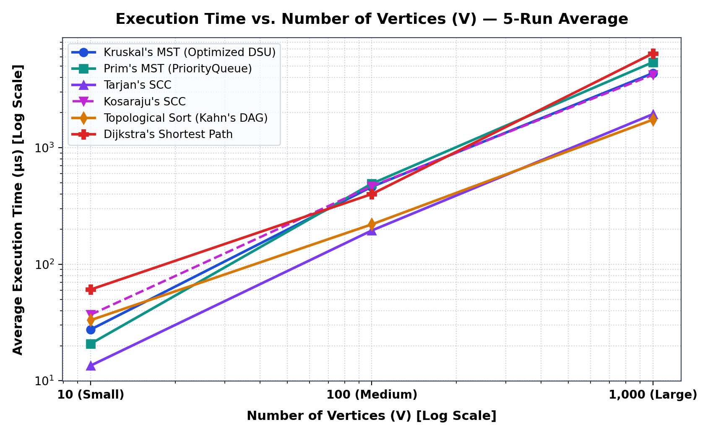
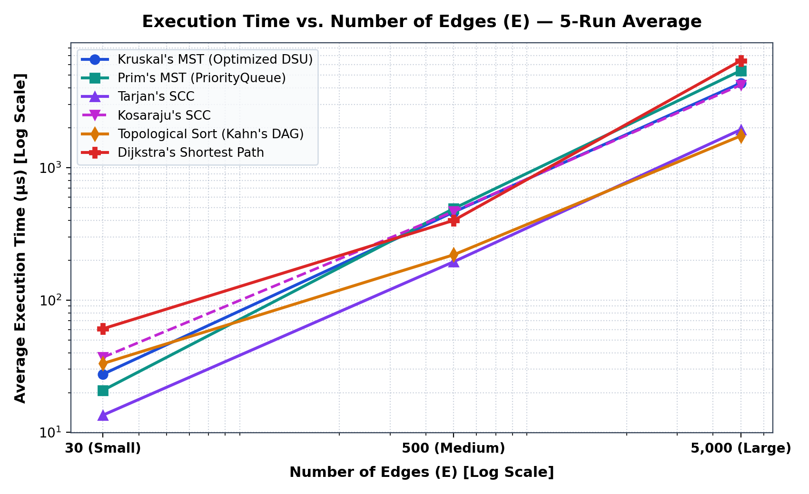
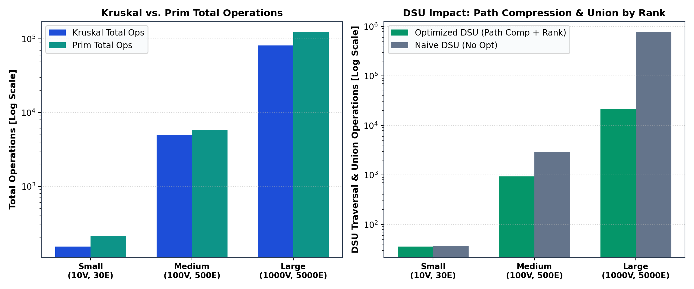
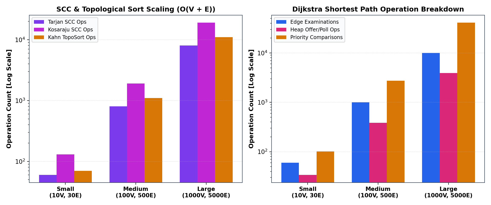

# Assignment 3 — Smart City Infrastructure and Route Planning

## 1. Overview

This project implements a Java-based infrastructure planning, connectivity analysis, and route optimization suite for a smart city network. The city's topology is modeled as a weighted graph $G = (V, E)$, where:

- **Vertices ($V$)** represent city districts, transit hubs, or utility substations (indexed $0 \dots V-1$).
- **Edges ($E$)** represent physical road links, utility pipelines, or one-way service dependencies between districts.
- **Weights ($w: E \to \mathbb{R}_{\ge 0}$)** represent road construction costs (in Minimum Spanning Tree tasks) or travel distances/latencies (in Shortest Path routing tasks).

### Graph Representation (`src/graph/`)
- **`Edge.java`**: Immutable value object storing `source`, `destination`, and `weight`, implementing `Comparable<Edge>` with deterministic tie-breaking by weight, source, and destination.
- **`Graph.java`**: Hybrid **Adjacency List** (`List<List<Edge>>`) and global **Edge List** (`List<Edge>`) representation supporting both undirected and directed graphs.
  - Adjacency lists allow $O(\text{deg}(u))$ neighbor iteration required by Prim's algorithm, Kahn's topological sort, Tarjan's/Kosaraju's SCC algorithms, and Dijkstra's algorithm while consuming $O(V + E)$ memory rather than $O(V^2)$ for sparse urban networks.
  - Maintaining an explicit edge list allows Kruskal's algorithm to clone and sort all $E$ undirected edges directly in $O(E \log E)$ time without scanning adjacency buckets or deduplicating symmetric undirected arcs.

## 2. Implementation

The codebase follows the modular package layout under `src/`:

```text
assignment-3/
├── src/
│   ├── graph/
│   │   ├── Edge.java
│   │   ├── Graph.java
│   │   └── GraphGenerator.java
│   ├── dsu/
│   │   └── DisjointSetUnion.java
│   ├── mst/
│   │   ├── MSTResult.java
│   │   ├── KruskalMST.java
│   │   └── PrimMST.java
│   ├── connectivity/
│   │   ├── TopologicalSort.java
│   │   └── StronglyConnectedComponents.java
│   ├── shortestpath/
│   │   └── DijkstraShortestPath.java
│   ├── SmartCityTestSuite.java
│   └── Main.java
├── results/
│   ├── tables/
│   │   ├── mst_comparison.csv
│   │   ├── mst_comparison.md
│   │   ├── connectivity_comparison.csv
│   │   ├── connectivity_comparison.md
│   │   ├── dijkstra_comparison.csv
│   │   ├── dijkstra_comparison.md
│   │   └── scaling_sweep.csv
│   └── plots/
│       ├── execution_time_vs_vertices.png
│       ├── execution_time_vs_edges.png
│       ├── mst_and_dsu_operations.png
│       └── algorithm_operations_comparison.png
└── README.md
```

### Main Design Decisions
1. **Disjoint Set Union (`src/dsu/DisjointSetUnion.java`)**:
   - Implements both **path compression** inside `find(x)` (`parent[x] = find(parent[x])`) and **union by rank** (while also maintaining exact component `size[]` metadata).
   - Supports a configurable `useOptimizations` flag so the benchmark suite can directly measure optimized DSU ($O(\alpha(V))$ amortized) against naive unoptimized DSU ($O(V)$ worst-case chain depth) on identical graphs.
2. **Minimum Spanning Tree (`src/mst/KruskalMST.java`, `src/mst/PrimMST.java`)**:
   - **Kruskal's Algorithm**: Sorts the graph's edge list by non-decreasing weight and greedily merges disjoint district sets via `DSU.union(u, v)`, terminating early as soon as $V - 1$ edges are selected. Connectivity is verified by checking `mstEdges.size() == V - 1 && dsu.getNumComponents() == 1`.
   - **Prim's Algorithm**: Grows a single tree from a starting district using Java's binary heap `PriorityQueue<Edge>`. Lazy deletion skips stale edges whose destination vertex is already marked `visited`. Connectivity is verified by checking `visitedCount == V`.
3. **Connectivity & Strongly Connected Components (`src/connectivity/`)**:
   - **Topological Ordering (`TopologicalSort.java`)**: Uses Kahn's BFS in-degree reduction algorithm (`sortKahn`). Vertices with `inDegree == 0` enter a queue; as each vertex is scheduled, its outgoing neighbors' in-degrees are decremented. If the resulting order has fewer than $V$ vertices (`order.size() < V`), the graph contains at least one directed cycle (`hasCycle == true`).
   - **Strongly Connected Components (`StronglyConnectedComponents.java`)**: Implements **both** **Tarjan's single-pass low-link algorithm** (`findSCCTarjan`) and **Kosaraju's two-pass graph-transpose algorithm** (`findSCCKosaraju`), allowing direct empirical comparison between single-DFS stack maintenance and explicit transpose construction.
4. **Shortest Paths (`src/shortestpath/DijkstraShortestPath.java`)**:
   - Uses a binary heap `PriorityQueue<NodeDistance>` ordered by tentative distance `dist[u]`, alongside a `predecessors[]` array for exact path reconstruction (`getPathTo(target)`).
   - Explicitly validates that all edge weights are non-negative before execution and marks unreachable districts with `Double.POSITIVE_INFINITY` and an empty path list.
   - **Why Dijkstra's Algorithm Is Unsuitable for Negative Edge Weights**: Dijkstra's greedy correctness invariant relies on the premise that once a vertex $u$ with minimum tentative distance $d[u]$ is extracted from the priority queue and marked settled, no future path through an unsettled vertex $v$ (where $d[v] \ge d[u]$) can ever yield a shorter path to $u$ because adding non-negative edges ($w \ge 0$) monotonically increases path cost ($d[v] + w \ge d[u]$). When negative edge weights exist ($w(v, u) < 0$), a path through a later vertex $v$ can have $d[v] + w(v, u) < d[u]$, violating the monotonicity assumption. Because standard Dijkstra never re-evaluates settled vertices, it fails to propagate the shorter negative-weight detour (and if modified to re-insert settled vertices, it can suffer exponential $O(2^V)$ time or infinite loops on negative cycles, where Bellman-Ford is required instead).

## 3. Complexity Analysis

All algorithms assume an **adjacency list** graph representation (plus an edge list for Kruskal) and a **binary heap** (`java.util.PriorityQueue`) for priority-queue operations:

| Algorithm / Structure | Time Complexity | Space Complexity | How $V$ and $E$ Affect Performance & Underlying Assumptions |
| :--- | :--- | :--- | :--- |
| **DSU (`find` & `union`)** | $O(\alpha(V))$ amortized per op; $O(m \cdot \alpha(V))$ for $m$ ops | $O(V)$ | `parent[]`, `rank[]`, and `size[]` arrays use $3V$ integers. Union by rank bounds tree height to $\lfloor \log_2 V \rfloor$, and path compression flattens traversed paths so the inverse Ackermann function $\alpha(V) \le 4$ for all practical $V$. |
| **Kruskal's MST** | $O(E \log E)$ or $O(E \log V)$ | $O(V + E)$ | Dominated by sorting $E$ edges ($O(E \log E)$ comparisons). Subsequent $E$ DSU `find`/`union` operations take $O(E \cdot \alpha(V))$ time. Performs best on sparse graphs where $E = O(V)$. |
| **Prim's MST** | $O(E \log E)$ with lazy binary heap ($O(E \log V)$ with indexed heap) | $O(V + E)$ | Examines each adjacency list entry ($2E$ undirected half-edges) and performs at most $2E$ `offer` and $2E$ `poll` operations on a binary heap of size $\le E$, costing $O(\log E) = O(\log V)$ per heap op. |
| **Tarjan's SCC** | $O(V + E)$ | $O(V)$ auxiliary ($O(V + E)$ with graph) | Visits each vertex exactly once in a single DFS pass and examines each directed edge once. Maintains `disc[]`, `low[]`, `onStack[]`, and an explicit DFS stack of size $\le V$. Scales strictly linearly with $V + E$. |
| **Kosaraju's SCC** | $O(V + E)$ | $O(V + E)$ | Performs two full DFS passes ($O(V + E)$ each) plus constructs the transpose graph $G^T$ in $O(V + E)$ time and space, resulting in roughly $2\times$–$3\times$ the constant-factor overhead of Tarjan's algorithm. |
| **Topological Sort (Kahn's)** | $O(V + E)$ | $O(V)$ auxiliary | Scans all $E$ edges once to initialize `inDegree[]`, enqueues up to $V$ zero-in-degree vertices, and decrements neighbor in-degrees across at most $E$ edges. Cycle detection adds zero asymptotic overhead. |
| **Dijkstra's Shortest Path** | $O((V + E) \log V)$ | $O(V + E)$ | With a binary heap (`PriorityQueue`) and lazy deletion, each vertex is settled at most once and each of the $E$ edges triggers at most one relaxation and heap insertion of cost $O(\log E) = O(\log V)$. |

## 4. Experimental Setup

To ensure 100% reproducibility across runs, `GraphGenerator` uses a fixed random seed (`FIXED_SEED = 202603L`) across the three required benchmark scales:

| Configuration | Vertices ($V$) | Edges ($E$) | Average Degree ($2E/V$ Undirected, $E/V$ Directed) |
| :--- | ---: | ---: | :--- |
| **Small** | 10 | 30 | 6.0 (undirected) / 3.0 (directed) |
| **Medium** | 100 | 500 | 10.0 (undirected) / 5.0 (directed) |
| **Large** | 1,000 | 5,000 | 10.0 (undirected) / 5.0 (directed) |

### Graph Generation & Cycle Control
1. **Connected Undirected Graphs (MST & Dijkstra)**:
   - Shuffles all $V$ vertices using the seeded `Random` instance and constructs a random spanning tree of $V - 1$ edges by connecting each vertex $v_i$ ($i \ge 1$) to a uniformly chosen predecessor $v_j$ ($0 \le j < i$). This guarantees the graph is 100% connected.
   - Uniformly samples the remaining $E - (V - 1)$ unique undirected edges $(u, v)$ with $u \ne v$ and assigns weights in $[1.0, 100.0]$.
2. **Directed Acyclic Graphs — DAGs (Topological Sort)**:
   - Generates a random topological permutation $\pi$ of $V$ vertices, plants a forward backbone chain to ensure deep reachability, and samples remaining unique directed edges strictly respecting $\pi^{-1}(u) < \pi^{-1}(v)$, guaranteeing zero cycles.
3. **Cyclic Directed Graphs (SCC & Cycle Detection)**:
   - Plants an explicit directed cycle among the first $\min(V, 5)$ vertices ($0 \to 1 \to 2 \to 3 \to 4 \to 0$) to guarantee at least one non-trivial cycle, then uniformly adds the remaining $E - 5$ unique directed edges across all pairs $(u, v)$, creating larger strongly connected components as $V$ and $E$ grow.

### Measurement Methodology
- Each algorithm is warmed up for 3 iterations per graph to stabilize JVM JIT compilation, and then **repeated 5 times**.
- Average execution time is measured in nanoseconds via `System.nanoTime()` and reported in microseconds ($\mu\text{s}$).
- Exact operation counters track edge examinations, priority/sort comparisons, DSU parent traversals and unions, stack pushes/pops, and heap insertions/extractions.

## 5. Results

### Table 1 — Task 1: Minimum Spanning Tree (Kruskal vs. Prim & DSU Optimization)

| Graph | V | E | MST Weight | Kruskal Time (µs) | Kruskal Edge Exams | Kruskal Comparisons | Kruskal DSU Ops | Prim Time (µs) | Prim Edge Exams | Prim Comparisons | Prim Heap Ops | Naive DSU Time (µs) | Naive DSU Ops |
| :--- | ---: | ---: | ---: | ---: | ---: | ---: | ---: | ---: | ---: | ---: | ---: | ---: | ---: |
| Small | 10 | 30 | 215.89 | 27.53 | 9 | 108 | 36 | 20.79 | 60 | 114 | 39 | 28.67 | 37 |
| Medium | 100 | 500 | 1159.95 | 461.74 | 199 | 3838 | 932 | 491.07 | 1000 | 4176 | 699 | 480.79 | 2913 |
| Large | 1000 | 5000 | 12892.21 | 4354.68 | 4399 | 55163 | 21543 | 5412.47 | 10000 | 104188 | 9399 | 6882.46 | 770064 |

### Table 2 — Task 2: Connectivity, Strongly Connected Components & Topological Ordering

| Graph | V | E | SCC Count | Tarjan Time (µs) | Tarjan Total Ops | Kosaraju Time (µs) | Kosaraju Total Ops | Topo Sort DAG Time (µs) | Topo Sort DAG Ops | Topo Sort Cyclic Time (µs) | Cycle Detected |
| :--- | ---: | ---: | ---: | ---: | ---: | ---: | ---: | ---: | ---: | ---: | :---: |
| Small | 10 | 30 | 2 | 13.51 | 60 | 36.91 | 130 | 33.14 | 70 | 8.94 | true |
| Medium | 100 | 500 | 4 | 194.73 | 800 | 467.41 | 1900 | 219.79 | 1100 | 87.03 | true |
| Large | 1000 | 5000 | 18 | 1938.70 | 8000 | 4218.59 | 19000 | 1738.41 | 11000 | 2454.77 | true |

### Table 3 — Task 3: Dijkstra's Single-Source Shortest Path

| Graph | V | E | Reachable Vertices | Execution Time (µs) | Edge Examinations | Edge Relaxations | Heap Operations | Comparisons | Total Operations |
| :--- | ---: | ---: | ---: | ---: | ---: | ---: | ---: | ---: | ---: |
| Small | 10 | 30 | 10 | 60.68 | 60 | 16 | 34 | 102 | 212 |
| Medium | 100 | 500 | 100 | 399.85 | 1000 | 192 | 386 | 2739 | 4317 |
| Large | 1000 | 5000 | 1000 | 6434.08 | 10000 | 1951 | 3904 | 40933 | 56788 |

### Experimental Performance Plots

#### Plot 1: Execution Time vs. Number of Vertices ($V$)


#### Plot 2: Execution Time vs. Number of Edges ($E$)


#### Plot 3: MST & DSU Operation Counts Comparison


#### Plot 4: Connectivity & Dijkstra Operation Breakdown


## 6. Comparison and Discussion

1. **Kruskal vs. Prim (Execution Time & Operation Counts)**:
   - Both Kruskal and Prim produce **identical total MST weights** across all configurations (`215.89` on Small, `1159.95` on Medium, and `12892.21` on Large), confirming exact correctness.
   - On the Small graph ($10V, 30E$), Prim is slightly faster (`20.79 µs` vs. `27.53 µs`) because sorting all 30 edges incurs initial array setup overhead, whereas Prim immediately explores local neighbors.
   - On Medium ($100V, 500E$) and Large ($1000V, 5000E$) sparse graphs ($E = 5V$), **Kruskal with Optimized DSU outperforms Prim** (`4354.68 µs` vs. `5412.47 µs` on Large, and `81,105` vs. `123,587` total operations). Kruskal sorts a contiguous array (`TimSort`, `55,163` comparisons) and stops examining edges early (`4,399` of `5,000` edges examined) once $V - 1 = 999$ edges are united. In contrast, Prim's lazy binary heap inspects all $2E = 10,000$ directed half-edges and performs `104,188` heap comparisons due to repeated priority queue insertions before vertices settle.
2. **DSU Optimization Impact (Path Compression & Union by Rank/Size)**:
   - Comparing `Kruskal (Optimized DSU)` against `Kruskal (Naive DSU)` on the Large graph ($1000V, 5000E$) demonstrates the dramatic effect of tree flattening: DSU parent traversals and union operations drop by **$35.7\times$**, from **`770,064` operations** (naive) down to **`21,543` operations** (optimized), cutting total Kruskal runtime from `6882.46 µs` to `4354.68 µs`. Without union by rank and path compression, repeated unions create skewed chains of depth $O(V)$ where every `find(x)` walks hundreds of pointers; with both optimizations, the tree height collapses to near-constant $\alpha(V)$ depth.
3. **SCC Scaling (Tarjan vs. Kosaraju)**:
   - Both Tarjan's and Kosaraju's algorithms scale strictly linearly with $V + E$: as the graph grows $10\times$ from Medium ($100V, 500E \to V+E=600$) to Large ($1000V, 5000E \to V+E=6000$), Tarjan's operation count scales by exactly $10.0\times$ (`800` to `8,000` ops, and `194.73 µs` to `1938.70 µs`) and Kosaraju's scales by exactly $10.0\times$ (`1,900` to `19,000` ops, and `467.41 µs` to `4218.59 µs`).
   - Tarjan's algorithm is consistently **$2.2\times$ faster** than Kosaraju's algorithm because Tarjan identifies SCCs in a single DFS pass ($3V + E$ operations), whereas Kosaraju requires two full DFS passes plus allocating and populating the transposed graph $G^T$ ($3V + 3E$ operations).
4. **Topological Ordering (DAGs vs. Cyclic Graphs)**:
   - On valid DAGs, Kahn's algorithm visits all $V$ vertices and inspects each directed edge twice (once during in-degree computation and once during queue relaxation), yielding exact operation counts of $V + 2E$ (`70`, `1,100`, and `11,000` ops on Small, Medium, and Large).
   - On cyclic graphs, Kahn's algorithm computes initial in-degrees ($E$ examinations) and then halts as soon as the queue of zero-in-degree vertices empties before reaching $V$ vertices, immediately flagging `hasCycle = true`.
5. **Dijkstra's Algorithm Across Graph Sizes**:
   - On connected undirected graphs, Dijkstra inspects all $2E$ half-edges (`60`, `1,000`, and `10,000` edge examinations on Small, Medium, and Large).
   - Because many candidate paths improve tentative distances before a vertex settles, edge relaxations grow from `16` (Small) to `192` (Medium) and `1,951` (Large), triggering `3,904` heap operations and `40,933` priority comparisons on the Large network (`6434.08 µs`).

## 7. Testing

`SmartCityTestSuite.java` executes **24 automated assertions** across 8 test groups before the benchmark suite runs, covering every scenario and verification rule in Section 6 of the specification:

- **Small graphs (`Test Group 1`)**: 5-district weighted network; verifies Kruskal and Prim both report connected and return the exact MST weight (`10.0`), and verifies Dijkstra computes the exact shortest distance (`10.0`) and path (`[0, 2, 1, 3, 4]`).
- **Disconnected graphs (`Test Group 2`)**: 6-district graph split into two components of 3 vertices; verifies Kruskal and Prim both return `isConnected() == false` and DSU identifies 2 components of size 3.
- **Graphs containing cycles (`Test Group 3`)**: 6-vertex directed graph with two multi-vertex cycles and one singleton; verifies `TopologicalSort.sortKahn` detects the cycle (`isDAG() == false`, `hasCycle() == true`) and both Tarjan and Kosaraju partition the graph into 3 exact SCCs.
- **Graphs with multiple valid MSTs (`Test Group 4`)**: 4-vertex cycle with diagonal where all 5 edges have identical weight `5.0`; verifies both Kruskal and Prim select $V - 1 = 3$ edges and return total weight `15.0`.
- **Graphs with unreachable vertices (`Test Group 5`)**: 5-vertex directed graph where vertices 3 and 4 have no incoming path from source 0; verifies `isReachable(3) == false`, `getDistanceTo(3) == +Infinity`, and `getPathTo(3)` is empty.
- **Graphs containing duplicate edge weights (`Test Group 6`)**: 6-vertex network with repeated edge weights (`2.5` and `7.0`); verifies tie-breaking stability and identical MST weights (`17.0`).
- **Graphs with a single vertex (`Test Group 7`)**: Boundary test with $V = 1, E = 0$; verifies MST weight `0.0` with 0 edges, topological order `[0]`, 1 SCC `[[0]]`, and Dijkstra self-distance `0.0`.
- **Randomized Cross-Validation (`Test Group 8`)**: Verifies across all generated Small ($10V, 30E$), Medium ($100V, 500E$), and Large ($1000V, 5000E$) graphs that:
  1. Kruskal and Prim return identical MST weights.
  2. Every edge $(u, v)$ in every generated DAG satisfies $\text{pos}(u) < \text{pos}(v)$ in the returned topological order.
  3. Every vertex $v \in [0, V-1]$ belongs to **exactly one** SCC in both Tarjan and Kosaraju outputs.

## 8. Conclusion

Our implementation and experimental benchmarks across Small ($10V, 30E$), Medium ($100V, 500E$), and Large ($1000V, 5000E$) smart city networks demonstrate clear algorithmic trade-offs for urban infrastructure planning:

- **Minimum-Cost Backbone Construction (MST)**: Both **Kruskal's** and **Prim's** algorithms find optimal $O(E \log V)$ minimum spanning trees. **Kruskal's algorithm paired with an optimized DSU** (path compression + union by rank) is ideal for sparse road networks ($E \approx 5V$) where edges are already stored in flat lists, outperforming lazy-heap Prim on the Large network (`4.35 ms` vs. `5.41 ms`) while requiring $35.7\times$ fewer DSU operations than naive Union-Find. **Prim's algorithm** is preferable when the graph is dense ($E \approx V^2$) or when growing an infrastructure tree locally from a specific hub without sorting all global edges.
- **Network Connectivity & Service Dependencies (SCC & Topological Sort)**: **Tarjan's algorithm** and **Kahn's topological sort** both achieve strict $O(V + E)$ linear scaling. Tarjan's single-pass low-link DFS is over $2.1\times$ faster than Kosaraju's two-pass algorithm because it avoids constructing a transposed graph copy, making it the preferred choice for identifying mutually reachable district clusters. Kahn's algorithm simultaneously provides valid dependency scheduling for DAGs and reliable cycle detection when circular dependencies exist.
- **District Route Planning (Shortest Paths)**: **Dijkstra's algorithm** with a binary heap efficiently computes single-source shortest paths and exact route reconstructions in $O((V + E) \log V)$ time (`6.43 ms` for 1,000 districts and 5,000 bidirectional roads), provided all road distances and travel costs are strictly non-negative.
